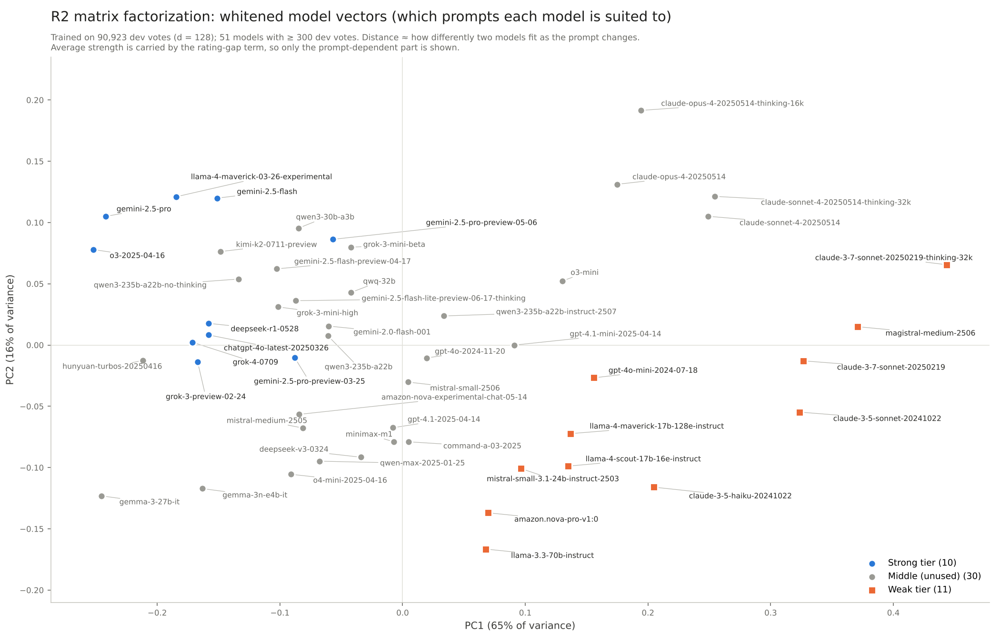

# llm-router-v2

**Headline** · ship a prompt-free price rule first, then a prompt-reading router on top: recovering half the strong–weak quality gap drops from $18.89 to $8.46 per 1,000 requests (dev set; test $16.96 → $8.05).

1. **Layer 1, price rule:** rank by rating gap ÷ price gap. No prompt and no trained router, yet 45–51% cheaper than always using the strong model.
2. **Layer 2, prompt-reading router (R2):** strong-vs-weak APGR rises from 0.529 to 0.612 on test (+0.083 [0.037, 0.128]); its extra 8–14% dollar saving is a point estimate whose test interval overlaps the baseline.
3. **The premium is on open-ended questions:** the strong tier wins 75% on advice and planning, but only 50% (28% ties) on code and single-answer questions.
4. **Labels for cold start, embeddings at scale:** 7 readable LLM labels trained on ~6,700 votes match R2 trained on ~90k votes, at ~$0.22 per 1,000 requests and ~1 s per request.
5. **Report gains as a range:** upper bound +0.054 dev / +0.083 test (strong vs weak, all pairs pooled); lower bound +0.02–0.03 within a single model pair (dev only).
6. **The cost is latency, not money:** routing costs ~$0.02 per 1,000 requests, but embedding the prompt on CPU takes 1.0 s at P90.


*R2's learned model vectors for 51 models. The strong tier sits at the negative, open-ended end of PC1: that, not difficulty, is where the expensive model earns its price.*

## Problem and evaluation framework

- **Task:** for each request, send it to an expensive strong model or a cheap weak one; score = P(strong wins) − P(strong loses), divided by the extra cost. Ties go to the cheap model.
- **Data:** LMArena human preference 140k (Apr–Jul 2025), first turn only, 101,058 votes, 53 models. Only real noise removed; votes never rewritten by an AI; ties kept as their own label.
- **Strong vs weak:** our own Bradley-Terry ratings; fixed lists at the gaps in the rank–rating plot: top 10 strong, ranks 41–51 weak.
- **Leakage control:** split by prompt group; 10% test set (10,135 votes), 5-fold CV on the rest; ratings refit inside every fold.
- **Metrics:** APGR (area under the quality-gap-recovered curve; random ≈ 0.5) and CPT(50%), on two x-axes: share of calls and dollars. 1,000 bootstrap resamples by prompt group.
- **Baselines:** rating gap only (call share); rating gap ÷ price gap (dollars). Every prompt-reading router is reported as Δ against these.
- **Discipline:** hyperparameters chosen inside training folds only; test set used twice under written pre-registrations (`reports/final_prereg.md`, `reports/r3_prereg.md`), then sealed.

## Three findings

**1. Reading the prompt helps, and the gain is real.** R2 (matrix factorization on e5-large embeddings) beats the rating-gap baseline in every call-share view on dev and test and meets both pre-registered criteria.
Shuffling the embeddings across prompts removes the whole gain; model identity without the prompt adds nothing.
The largest gain is between models of similar strength (rating gap < 50: +0.13). Details: `reports/final_test_report.md`.

**2. The signal is "does this prompt separate strong from weak", not "is it hard".** PC1 of the model vectors (65% of variance) runs from open-ended advice (strong wins 75%) to code and definite-answer questions (50%).
Difficulty is similar at both ends (33% vs 43% hard), and the pattern holds on English-only votes.
On English-only votes the strong tier's win rate still falls from 76% to 50% along PC1, so it is not a language effect.
Details: `reports/r2_prompt_axes.md`.

**3. Seven readable labels nearly replace the embedding.** Claude Haiku 5.5 tagged 9,247 prompts for about $0.97 (Batch API); a router on those labels (R3) reaches +0.063 on test vs +0.083 for full R2 (difference not significant).
At equal training data, labels beat embeddings on dev (+0.046, significant) and point the same way on test (+0.030 [−0.010, 0.065], not significant).
Details: `reports/r3_dev_report.md`, `reports/r3_test_report.md`.

## Reproduce

**Core path (no GPU, no API key; ends at the random baseline).** Python 3.13. Run from an empty environment on 4 CPU cores in about 13 minutes after the download; its step reports matched the earlier committed versions (in the git history) byte for byte.

```bash
python -m venv .venv && source .venv/bin/activate
pip install -r requirements.txt
python -I data/download.py raw/              # 7 parquet shards, ~1.6 GB, SHA-256 checked
python -I scripts/clean.py raw/ .            # 108,315 -> 101,058 first-turn votes
python -I scripts/tier_models.py .           # Bradley-Terry ratings on all data (descriptive only)
python -I scripts/make_labels.py .           # labels, ties, prompt group ids
python -I scripts/split.py .                 # test set + 5 dev folds, seed 2026
python -I scripts/fold_ratings.py .          # ratings refit per fold, strong/weak view
python -I scripts/evaluate.py . --demo       # random router APGR ≈ 0.50, rating-gap baseline
```

**Full path (optional).** Needs `pip install -r requirements-full.txt`. Stage-by-stage scripts are in [scripts/README.md](scripts/README.md); each script's header documents its arguments.

- The embedding step was run on Colab: T4 GPU, sentence-transformers, batch 128, 95,373 prompts in 37 min 39 s (`scripts/colab_embed.py`). On 4 CPU cores it takes about 5 hours (extrapolated: 2,000 random prompts took 382 s with sentence-transformers on CPU, batch 128). For CPU, run `colab_embed.py` with `device="cpu"`, or `embed_prompts.py` (fastembed / ONNX, not timed).
- R3 labels ship in `r3/r3_labels.jsonl`. Re-labeling with `r3/r3_label.py` needs `ANTHROPIC_API_KEY`, costs about $1 on the Batch API, and will not match row for row.

## Reports

Full report: [English](reports/report_en.md) · [Chinese](reports/report_zh.md). `reports/` keeps only the main write-ups: data, approach 1, approach 2, overhead, and the two test-set reports with their pre-registrations. Step reports, per-router evaluation tables and tuning logs are written by the scripts when you run them (see [scripts/README.md](scripts/README.md)).

Data: [lmarena-ai/arena-human-preference-140k](https://huggingface.co/datasets/lmarena-ai/arena-human-preference-140k), prompts under CC-BY-4.0 (see `data/README.md`). Code: MIT.
