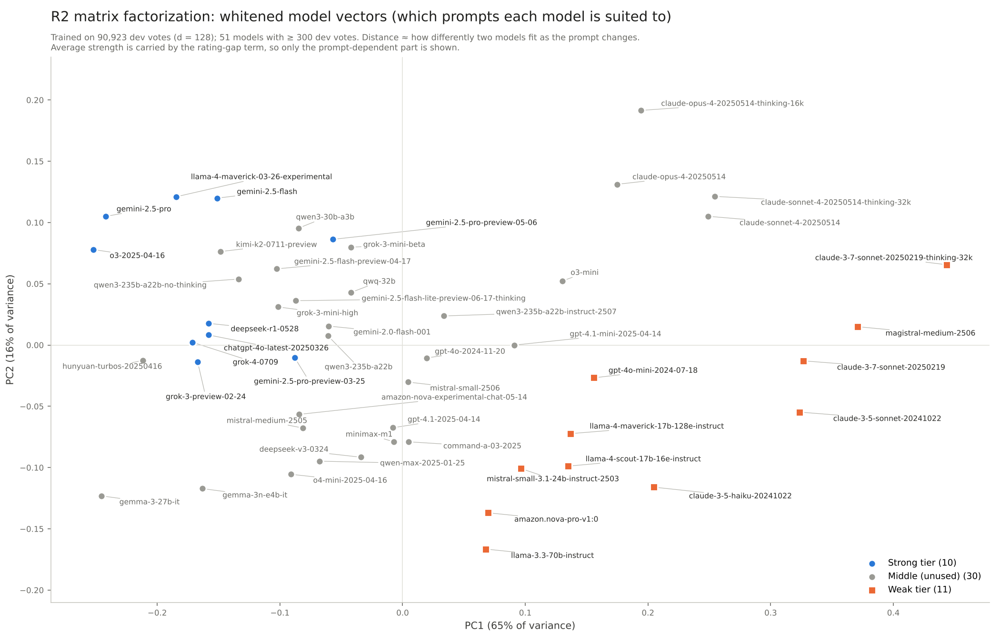

# LLM Router v2 Report

Nov 10, 2026 · @Yiqing

## Problem and setting

The product runs an expensive strong model and a cheap weak model side by side. For every request the router decides which one answers, aiming for as much user preference as possible for as little money as possible.

- **Why it is worth doing:** In the main case the strong model's median per-request cost is 6.1× the weak model's (P10–P90: 1.9× to 33×). Yet across all strong-vs-weak battles the strong model wins only 62%, with 21% ties. Many requests can go to the cheap model without users noticing a difference.
- **The question the router answers:** How much more quality do we expect from the strong model on this request? Divide that by the extra cost; the highest scores go to the strong model first. Expected quality = P(strong wins) − P(strong loses), ties count 0. On a tie the weak model is routed: no quality lost, and cheaper.
- **A side finding:** In 33% of dev-set battles the higher-rated side is also the cheaper one (typically gemini-2.5-flash, qwen3 or mistral-medium beating claude-opus-4 / sonnet-4). Those pairs need no router: use the cheap one.

## Evaluation framework (shared by both approaches)

| Step | Method |
| --- | --- |
| Data | LMArena human preference, 140k battles (Apr–Jul 2025), first turn only; 101,058 votes and 53 models after cleaning. Only genuine noise removed; human votes never rewritten by an AI; ties kept as a separate label |
| Strong vs weak | Bradley-Terry ratings fitted on the data itself. Fixed lists set at the gaps in the rank–rating plot: top 10 = strong tier, ranks 41–51 = weak tier, 30 middle models unused |
| Leakage control | Grouped by prompt; 10% held-out test set (10,135 votes); 5-fold cross-validation on the rest. Ratings refitted inside each fold on training votes only |
| Metrics | APGR: sort requests by router score, send progressively more to the strong model, measure the share of the strong–weak quality gap recovered, take the area under the curve. Random ≈ 0.5, perfect ≈ 1. CPT(50%): the cost needed to recover half the gap |
| Two x-axes | Call share (fraction of requests sent to the strong model); dollars (extra spend, using only votes where the higher-rated side is also pricier) |
| Baselines | Call-share axis: rating gap only, no prompt. Dollar axis: rating gap ÷ price gap, with win/tie/loss rates estimated per rating-gap bucket |
| Hyperparameters | Chosen only inside each fold's training portion. Test set evaluated per a pre-registration written in advance; used twice, then sealed |

Two evaluation views are used. ① Pooled: all model pairs mixed; results depend on which pairs Arena happened to sample and do not represent any single product. ② Strong vs weak tier: closer to a concrete deployment.

## Headline conclusions and recommendations

**Ship a price rule that ignores the prompt first, then a prompt-reading router on top.** Together, in the main case, they cut the cost of recovering half the quality gap from $18.89 per 1,000 requests (all-strong) to $8.46 (dev set; $16.96 → $8.05 on the test set).

- **Layer 1, the price-aware rule:** Rank by rating gap ÷ price gap. No prompt, no trained router model, and it saves 45–51% versus sending everything to the strong model.
- **Layer 2, the prompt-reading router (R2, matrix factorization):** On the call-share axis it lifts strong-vs-weak APGR from 0.529 (rating-gap-only baseline) to 0.612 (test set, +0.083 \[0.037, 0.128\]) and passes the pre-registered success criteria. On the dollar axis it saves a further 8–14% on top of layer 1 (point estimate; the test-set interval overlaps the baseline). The gain is largest for pairs of similar strength; that is where it should be used.
- **The expensive model's premium is on open-ended questions.** On recommendations and planning the strong tier wins 75%; on bug fixes and questions with a definite answer it wins only 50% with 28% ties. Routing the latter to the cheap model loses little.
- **Semantic labels for cold start, embeddings at scale.** Seven readable labels trained on \~6,700 votes match an embedding router trained on 90k votes, but cost \~$0.22 more per 1,000 requests and add \~1 s per request (measured on a 50-prompt real-time API pilot). The axes they capture overlap heavily: relative to full R2, combining them adds nothing; relative to R2-②, trained on tier-② votes only, the combination gains +0.035 \[0.003, 0.071\] on the test set.
- **Report gains as a range, not a point.** Upper bound: pooled strong-vs-weak ranking, +0.054 dev / +0.083 test. Lower bound: the within-pair metric for a single-pair product, 0.02–0.03 above random (dev set only).
- **The cost is latency, not money.** Routing overhead is \~$0.02 per 1,000 requests, but computing the prompt embedding on CPU takes 1.0 s at P90. Move to GPU or a smaller embedding model before launch.

## Comparing the two approaches: embeddings vs semantic labels

**Both approaches are complete and the test set is sealed.** They share the same data, baselines and metrics; the only difference is how the prompt is read. Approach 1 turns the prompt into a 1,024-dimensional vector with an open-source multilingual model; the routers are logistic regression (R1, control) and matrix factorization (R2, main). Approach 2 has Claude Haiku 5.5 tag each prompt with 7 readable fields (task type, single-answer, open-endedness, creativity, format constraint, difficulty, expected length); the router is labels + rating gap + model identity (R3), plus an R2 + R3 combination. Approach 2 costs about $1.0 one-off to label 9,247 prompts (Batch) and every field is directly readable; approach 1's vectors are opaque and can only be interpreted afterwards through a projection plot.

|  | Approach 1: embeddings (R1 / R2) | Approach 2: semantic labels (R3) |
| --- | --- | --- |
| Strong-vs-weak ΔAPGR (test) | R2 +0.083 \[0.037, 0.128\]; R1 +0.046 \[0.009, 0.087\] | R3 +0.063 \[0.017, 0.108\]; R2 + R3 +0.068 \[0.025, 0.115\] |
| Trained on the same \~6,700 tier-② votes (dev ΔAPGR) | R2-② +0.006 (+0.026 with relaxed early stopping) | R3 +0.051 \[0.039, 0.066\]; +0.046 over R2-②, significant; +0.030 on test, not significant |
| Dollar main case ΔAPGR$ (test) | R2 +0.014; R1 +0.021 (neither significant) | R3 0.000; R2 + R3 +0.003 (neither significant) |
| Online overhead per 1,000 / added latency (median / P90) | \~$0.02 / 0.19 s / 1.0 s (CPU) | \~$0.22 / 1.1 s / 1.4 s (50-prompt pilot) |

The test set was used twice: first for approach 1, then for approach 2, and then sealed. Approach 2's labeling design was fixed before the first test-set results; its training grid and success criteria (reports/r3\_prereg.md) were written after that and before the full labels were produced (after a 50-prompt pilot). The formal comparison of the two approaches is on the dev set, 5-fold (same folds, same baselines, paired bootstrap). See reports/r3\_dev\_report.md and reports/r3\_test\_report.md.

## Conclusions on approach 2

**Seven readable semantic labels, trained on only \~6,700 votes, match an embedding router trained on 90,000 votes.** On the dev set R3 beats the rating-gap baseline by +0.051 and full R2 beats it by +0.056; the paired difference of −0.005 includes 0. On the test set R3 is +0.063 and full R2 +0.083, again not significantly different.

- **At equal data, labels beat embeddings:** significant on the dev set (R3 − R2-② = +0.046 \[0.034, 0.057\]; still +0.026 after relaxing R2-②'s early stopping), same direction but not significant on the test set (+0.030 \[−0.010, 0.065\]).
- **Why labels suffice:** is\_open\_ended has a rank correlation of −0.46 with PC1, the main axis approach 1 learned, and task types line up along PC1 as advice → factual → writing → math → code. The hand-defined fields deliver the most useful signal directly: whether this kind of prompt separates strong from weak.
- **Stacking adds nothing:** R2 + R3 ties with full R2 (dev −0.002, test −0.015, neither significant).
- **No advantage on the dollar axis:** routers trained on tier-② votes only do not beat the rating-gap ÷ price-gap baseline in the dollar main case (R3 dev −0.009, test 0.000). Likely too few votes to estimate each pair's strength and tie rate.
- **By has\_single\_answer:** for scores 0–2 both approaches gain about the same (+0.04 to +0.06). On clearly single-answer prompts (score 3, 373 dev votes) every router trails the rating-gap baseline.

**Recommendation:** with plenty of preference data use embeddings (R2) at \~$0.02 per 1,000 routed requests; for cold start with only a few thousand votes use semantic labels (R3), paying \~$0.22 more per 1,000 requests and \~1 s more per request (50-prompt pilot) for routing decisions that are readable and auditable.

## Approach 1 results (R1 / R2)

**R2 beats the rating-gap-only baseline in every call-share view on both dev and test sets. On the dollar axis its difference from the rating-gap ÷ price-gap baseline is not significant.** R1 (linear logistic regression) is the control and shows no gain on closely matched pairs.

**Call-share axis, versus the rating-gap baseline (ΔAPGR, test set with 95% CI)**

| View | Test votes | R2 dev | R2 test | R1 dev | R1 test |
| --- | --- | --- | --- | --- | --- |
| ② Strong vs weak | 999 | +0.054 | **+0.083** \[0.037, 0.128\] | +0.047 | +0.046 \[0.009, 0.087\] |
| ① Rating gap > 150 | 1,028 | +0.054 | **+0.074** \[0.031, 0.125\] | +0.046 | +0.032 \[−0.004, 0.073\] |
| ① Rating gap 50–150 | 5,038 | +0.059 | +0.075 \[0.049, 0.103\] | +0.036 | +0.048 \[0.028, 0.072\] |
| ① Rating gap < 50 | 4,069 | +0.133 | +0.130 \[0.012, 0.292\] | −0.012 | −0.082 (n.s.) |
| ① Pooled | 10,135 | +0.043 | +0.056 \[0.037, 0.076\] | +0.015 | +0.016 \[0.002, 0.031\] |

- **Pre-registered success criterion:** both the ② and the > 150 rows must have intervals excluding 0. R2 passes; R1 does not.
- R2's test-set point estimates sit slightly above the dev set in most views, but the dev numbers fall inside the test intervals. This means the conclusions survived, not that the test set is better.
- **The gain comes from prompt content.** Shuffling prompt vectors across prompts and retraining removes all of it; adding model identity without the prompt gives no gain.

**Upper and lower bounds (reported together)**

- **Upper bound: the ② strong-vs-weak Δ.** It ranks 99 model pairs together and includes cross-pair gains (sending the strong model first in the pairs with the widest gap), which a single-pair product cannot capture.
- **Lower bound: within-pair APGR$.** Ranking inside each model pair, weighted by votes. Dev set: R1 0.528 \[0.510, 0.548\], R2 0.522 \[0.506, 0.546\], 0.02–0.03 above random (0.5). On the test set only 3 pairs have ≥ 30 votes, so it cannot be estimated.

**Dollar axis (versus rating gap ÷ price gap):** main-case ΔAPGR$ on the test set is R2 +0.014 \[−0.021, 0.068\] and R1 +0.021 \[−0.007, 0.051\]; on the dev set +0.008 / +0.011. Price gaps (1.9× to 33×) dominate the ranking; the prompt signal is a small addition.

## Cost and inference overhead

**Routing overhead is about $0.02 per 1,000 requests, 1–3% of what prompt reading saves. The real cost is latency.** The table shows cost per 1,000 requests at the point where half the strong–weak gap is recovered, main case.

| Routing | Dev set | Test set | Routing overhead | Added latency (median / P90, 4-core CPU) |
| --- | --- | --- | --- | --- |
| All to strong model | $18.89 | $16.96 | 0 | 0 |
| Rating gap ÷ price gap (formal baseline) | $9.23 | $9.34 | ≈ 0 | ≈ 0 |
| R1 / R2 (prompt-reading) | $8.46 | $8.05 | \~$0.02 | 0.19 s / 1.0 s |

- Prompt reading saves $0.77 (8%) over the formal baseline on the dev set and $1.29 (14%) on the test set. The test-set intervals overlap the baseline, so both figures are reported.
- Nearly all overhead is the prompt embedding (multilingual-e5-large). Priced at \~$0.17 per hour for a 4-core cloud VM, not verified live; even at 10× the conclusion holds. The routing head itself takes under 0.02 ms.
- A P90 wait of \~1 s on CPU is noticeable in a chat product. Options to test: GPU inference, a smaller embedding model, truncating at 128 tokens instead of 512, overlapping with first-token generation. None measured yet.

## What approach 1 learned

**R2's strongest signal is not how hard a prompt is, but whether this kind of prompt separates strong from weak.** Projecting the 51 model vectors onto two principal axes makes this visible.

| Axis | One end | Other end | Meaning for routing |
| --- | --- | --- | --- |
| PC1 (65%): open-ended advice ↔ code and definite-answer questions | Recommendations, learning paths, "how to make money with AI": strong tier wins 75% | Bug fixes from pasted code, logic puzzles, "answer in one word": strong tier wins 50%, ties 28% | Open-ended advice is worth the strong model; code and definite-answer questions lose little on the cheap one |
| PC2 (16%): short common knowledge ↔ specialist hard problems | One-line English factual questions, 2.5% hard | Long Chinese/Japanese tasks in embedded systems, physics, motor control, 75% hard | llama-3.3, nova-pro and gemma fall behind on specialist problems; this axis overlaps heavily with language |

- Difficulty is similar at both ends of PC1: 33% vs 43% hard by Arena's label. Recomputed on English votes only, the strong-tier win rate still falls from 76% to 50%, so it is not a language effect.
- A hypothesis: open-ended questions have no reference answer, so breadth and organization separate the models; on questions with a right answer the weak model is often right too. The weak-tier Claude 3.5 / 3.7 Sonnet sit toward the code end, which may mean Arena's overall rating underrates their coding.
- Projection plot below; file: reports/r2\_model\_vectors\_pca.png.

Figure: the R2 vectors of 51 models projected onto two principal axes. The strong tier clusters at the negative end of PC1, i.e. it has the edge on open-ended advice questions.

## Limitations

- **Arena is not your users.** Voters, prompt mix and model pairings are set by Arena (e.g. Polish jumped to 12–24% of prompts from June 2025). Re-validate on your own traffic before launch.
- **Labels are human preference, not correctness.** 37% of repeated prompts have contradictory verdicts; the majority-vote ceiling is 79.5%.
- **Costs are underestimated.** Cost = list price × visible answer length; hidden reasoning tokens are excluded. The strong tier contains more reasoning models (o3, gemini-2.5-pro, deepseek-r1), so the true price gap is probably larger. A sensitivity check multiplying output tokens by 2–5× is advised.
- **The lower bound comes from the dev set only.** Too few test-set pairs have enough votes for the within-pair metric.
- **The test set is small.** View ② has 999 votes; intervals are about 3× wider than on the dev set.
- **No style control.** BT ratings are not adjusted for answer length or formatting, so "strength" includes style preference.

## Next steps

1. **R3 was completed on 2026-11-11 (see approach 2).** For the cold-start route, the follow-up is replacing Haiku with a cheaper local model, or calling Haiku only when the embedding router is uncertain, to bring the $0.22 per 1,000 overhead down.
2. **Latency:** benchmark e5-large on GPU; compare e5-small and 128-token truncation against APGR.
3. **Pre-launch validation:** a small A/B on your own product's model pair, with expectations set by the within-pair lower bound (0.02–0.03 above random).
4. **Pairs that need no router:** where the higher-rated side is cheaper (33% of the dev set), use the cheap model directly.

Full numbers and scripts are in this repository: test-set results in reports/final\_test\_report.md, overhead in reports/overhead\_table.md, R2 implementation in reports/r2\_implementation.md.
