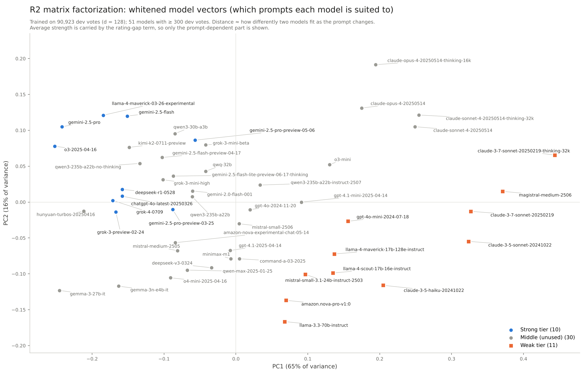

# LLM 路由器 v2：PM 报告

Nov 10, 2026 · @Yiqing

## 问题与场景

产品同时接了一个贵的强模型和一个便宜的弱模型。对于每条请求，路由器要决定发给哪一个，目标是用尽量少的钱拿到尽量多的用户偏好。

- **为什么值得做：** 在主案例里，强模型单次成本的中位数是弱模型的 6.1 倍（P10 到 P90 是 1.9 倍到 33 倍）。但在全部强弱档对战里，强模型只赢了 62%，平局占 21%。也就是说，很多请求发给便宜模型，用户并不会觉得更差。
- **路由器要回答的问题：** 发给强模型时，这条请求预期能多得多少质量？拿这个数除以多花的钱，得分高的先发强模型。预期质量 = P(强模型赢) − P(强模型输)，平局计 0。平局时发弱模型不损失质量，还更便宜。
- **一个顺带的发现：** 开发集里有 33% 的对战，是评分更高的一方反而更便宜（常见的是 gemini-2.5-flash、qwen3、mistral-medium 赢 claude-opus-4 / sonnet-4）。这些配对不需要路由，直接用便宜的那个就行。

## 评估框架（两种方案共用）

| 环节 | 做法 |
| --- | --- |
| 数据 | LMArena 人类偏好 140k（2025 年 4 到 7 月），只用会话第一轮，清洗后 101,058 票、53 个模型。只清真噪声，不用 AI 改人类投票，平局单独标出 |
| 谁强谁弱 | 用 Bradley-Terry 模型自己算评分。按名次–分数图上的断层，固定前 10 名为强档、第 41 到 51 名为弱档，中间留 30 个模型不用 |
| 防泄漏 | 按 prompt 分组，切出 10% 测试集（10,135 票），剩下的开发集做 5 折交叉验证。评分在每一折里只用训练票重新拟合 |
| 指标 | APGR：把请求按路由器给的分数排序，逐步多发给强模型，看质量收回强弱差距的比例，取曲线下面积。随机排序约 0.5，完美排序接近 1。CPT(50%)：收回一半差距需要的成本 |
| 两种横轴 | 按调用比例（多少请求发给强模型）；按美元（多花了多少钱，只用高分方同时更贵的票） |
| 基线 | 调用比例口径：只看评分差、不看 prompt。美元口径：评分差 ÷ 价格差，并且按评分差分桶估计赢 / 平 / 输的比例 |
| 选参 | 超参数只在开发集每一折的训练部分内部选。测试集按事先写好的登记评估，共用两次后封存 |

这里有两个指标口径。① 合并：全部模型对混在一起，结果受 Arena 抽到哪些配对的影响，不代表单一产品。② 强弱档：只看强档 vs 弱档的对战，更接近具体场景。

## 总结论与建议

**先上一条不看 prompt 的价格规则，再上读 prompt 的路由器。** 两层加起来，在主案例里把收回一半质量差距的成本从全发强模型的每千次 $18.89 降到 $8.46（开发集；测试集是 $16.96 降到 $8.05）。

- **第一层，价格感知规则：** 按「评分差 ÷ 价格差」排序，不看 prompt、不用训练路由模型，就比全发强模型省 45% 到 51%。
- **第二层，读 prompt 的路由器（R2，矩阵分解）：** 按调用比例算，强弱档 APGR 从只看评分差的基线 0.529 提到 0.612（测试集 +0.083 \[0.037, 0.128\]），通过了事先登记的成功标准。按美元算，它在第一层之上再省 8% 到 14%（点估计，测试集区间与基线重叠）。收益在两个模型实力接近的配对里最明显，建议用在这类场景。
- **贵模型的溢价在开放式问题上。** 推荐、规划这类题强档赢 75%；贴代码改 bug、有确定答案的题强档只赢 50%、平局 28%。后者发便宜模型损失很小。
- **冷启动用语义标签，有大数据用 embedding。** 7 个可读标签只用约 6,700 票就追平了用 9 万票训练的 R2，但每千次路由多花约 $0.22，每条请求多约 1 秒延迟（50 条实时 API 试打实测）。两者学到的轴高度重合：相对全量 R2，叠加没有额外收益；相对只用 ② 票的 R2-②，组合在测试集上有 +0.035 \[0.003, 0.071\]。
- **收益按区间报，不报单个数。** 上限是强弱档混合排序的提升（开发集 +0.054，测试集 +0.083）；下限是单一配对产品的配对内指标，比随机高 0.02 到 0.03，这个数只能来自开发集。
- **代价在延迟，不在钱。** 路由开销每千次约 $0.02，但在 CPU 上算 prompt 向量 P90 要 1.0 秒，上线前要换 GPU 或更小的向量模型。

## 两种方案对比：embedding vs 语义标签

**这个实验比较两种「读 prompt」的路由方案。两种方案都已完成，测试集已封存。** 两种方案用同一套数据、同样的基线和指标，差别只在「怎么读 prompt」。方案一用开源多语言模型把 prompt 变成 1024 维向量，路由器是逻辑回归（R1，对照）和矩阵分解（R2，主）。方案二让 Claude Haiku 5.5 给每条 prompt 打 7 个可读字段（任务类型、是否有唯一答案、开放程度、创意、格式约束、难度、预期长度），路由器是标签 + 评分差 + 模型身份（R3），另加 R2 + R3 组合。方案二一次性打标费用约 $1.0（Batch），每个字段都能直接读；方案一的向量不可读，只能事后用投影图解释。

|  | 方案一：embedding（R1 / R2） | 方案二：语义标签（R3） |
| --- | --- | --- |
| 强弱档 ΔAPGR（测试集） | R2 +0.083 \[0.037, 0.128\]；R1 +0.046 \[0.009, 0.087\] | R3 +0.063 \[0.017, 0.108\]；R2 + R3 +0.068 \[0.025, 0.115\] |
| 同样只用 ② 的约 6,700 票训练（开发集 ΔAPGR） | R2-② +0.006（早停放宽后 +0.026） | R3 +0.051 \[0.039, 0.066\]，比 R2-② 高 +0.046，显著；测试集上高 +0.030，不显著 |
| 美元主案例 ΔAPGR$（测试集） | R2 +0.014；R1 +0.021（都不显著） | R3 0.000；R2 + R3 +0.003（都不显著） |
| 线上每千次开销 / 额外延迟（中位 / P90） | 约 $0.02 / 0.19 秒 / 1.0 秒（CPU） | 约 $0.22 / 1.1 秒 / 1.4 秒（50 条试打） |

测试集一共用了两次：先是方案一（2026-11-10），再是方案二（2026-11-11），之后封存。方案二的打标方案在第一次测试集结果出来之前就定了；训练网格和判定标准（reports/r3\_prereg.md）是在那之后、拿到全量标签之前（50 条试打之后）写的。两种方案的正式对比放在开发集 5 折上（同折、同基线、配对 bootstrap）。详见 reports/r3\_dev\_report.md 和 reports/r3\_test\_report.md。

## 方案二的结论

**7 个可读的语义标签，只用约 6,700 张票训练，就达到了用 9 万张票训练的 embedding 路由器（R2）的水平。** 开发集上 R3 比评分差基线高 +0.051，全量 R2 比基线高 +0.056，两者的配对差 −0.005，区间含 0。测试集上 R3 +0.063，全量 R2 +0.083，配对差同样不显著。

- **同样数据量下，标签胜过 embedding：** 开发集显著（R3 − R2-② = +0.046 \[0.034, 0.057\]；R2-② 放宽早停后差距仍有 +0.026），测试集方向一致但不显著（+0.030 \[−0.010, 0.065\]）。
- **为什么标签够用：** is\_open\_ended 和方案一学到的主轴 PC1 的秩相关是 −0.46，任务类型也按「咨询 → 常识 → 写作 → 数学 → 代码」在 PC1 上排开。人工定义的字段直接给出了「这题能不能拉开强弱差距」这个最有用的信号。
- **两者叠加没有额外收益：** R2 + R3 和全量 R2 打平（开发集 −0.002，测试集 −0.015，都不显著）。
- **美元口径没有优势：** 只用 ② 票训练的路由器在美元主案例上都不超过「评分差 ÷ 价格差」基线（R3 开发集 −0.009，测试集 0.000）。推测是票太少，估不准每对模型的实力和平局率。
- **按 has\_single\_answer 分组：** 0 到 2 分的题，两种方案的提升差不多（+0.04 到 +0.06）。明确有唯一答案的题（3 分，开发集 373 票）上，所有路由器都不如评分差基线。

**建议：** 有大量偏好数据时用 embedding（R2），每千次路由只要约 $0.02；冷启动、只有几千张票时用语义标签（R3），代价是每千次多约 $0.22、每条请求多 1 秒左右延迟（50 条试打实测），换来的是可读、可审计的路由依据。

## 方案一的结果（R1 / R2）

**R2 在开发集和测试集的每个调用比例口径上都超过了只看评分差的基线。在美元口径上，它和「评分差 ÷ 价格差」基线的差别不显著。** R1（线性的逻辑回归）是对照，在实力接近的配对上没有提升。

**按调用比例，和只看评分差的基线比（ΔAPGR，测试集带 95% 区间）**

| 口径 | 测试集票数 | R2 开发集 | R2 测试集 | R1 开发集 | R1 测试集 |
| --- | --- | --- | --- | --- | --- |
| ② 强弱档 | 999 | +0.054 | **+0.083** \[0.037, 0.128\] | +0.047 | +0.046 \[0.009, 0.087\] |
| ① 评分差 > 150 | 1,028 | +0.054 | **+0.074** \[0.031, 0.125\] | +0.046 | +0.032 \[−0.004, 0.073\] |
| ① 评分差 50–150 | 5,038 | +0.059 | +0.075 \[0.049, 0.103\] | +0.036 | +0.048 \[0.028, 0.072\] |
| ① 评分差 < 50 | 4,069 | +0.133 | +0.130 \[0.012, 0.292\] | −0.012 | −0.082（不显著） |
| ① 合并 | 10,135 | +0.043 | +0.056 \[0.037, 0.076\] | +0.015 | +0.016 \[0.002, 0.031\] |

- **预登记的成功标准**是② 和「> 150」两行的区间都不含 0。R2 达到了，R1 没有。
- R2 在多数口径上测试集比开发集略高，但开发集的数都落在测试集区间里。这只说明结论没被推翻，不能说测试集上更好。
- **提升确实来自 prompt 内容。** 把 prompt 向量在 prompt 之间随机打乱后重训，提升全部消失。只加模型身份、不加 prompt，也没有提升。

**上限与下限（并报）**

- **上限：② 强弱档的 Δ。** 它把 99 个模型对混在一起排序，包含「先在强弱差距大的配对里发强模型」这种跨配对的收益，只有一对模型的产品拿不到。
- **下限：配对内 APGR$。** 在同一对模型内部单独排序，再按票数加权。开发集上 R1 是 0.528 \[0.510, 0.548\]，R2 是 0.522 \[0.506, 0.546\]，比随机的 0.5 高 0.02 到 0.03。测试集里票数 ≥ 30 的模型对只有 3 个，估计不出来。

**美元口径（和「评分差 ÷ 价格差」比）：** 主案例的 ΔAPGR$ 在测试集上是 R2 +0.014 \[−0.021, 0.068\]、R1 +0.021 \[−0.007, 0.051\]，开发集是 +0.008 / +0.011。价格差（1.9 到 33 倍）主导了排序，prompt 信号是叠加上去的一小部分。

## 成本与推理开销

**路由开销每千次约 $0.02，是读 prompt 多省下的钱的 1% 到 3%。真正的代价是延迟。** 下表是主案例在收回一半强弱差距时的每千次请求成本。

| 路由方式 | 开发集 | 测试集 | 路由开销 | 额外延迟（中位 / P90，4 核 CPU） |
| --- | --- | --- | --- | --- |
| 全发强模型 | $18.89 | $16.96 | 0 | 0 |
| 评分差 ÷ 价格差（正式基线） | $9.23 | $9.34 | ≈ 0 | ≈ 0 |
| R1 / R2（读 prompt） | $8.46 | $8.05 | 约 $0.02 | 0.19 秒 / 1.0 秒 |

- 读 prompt 比正式基线开发集省 $0.77（8%），测试集省 $1.29（14%）。测试集的区间和基线重叠，所以两个数一起报。
- 路由开销几乎全来自算 prompt 向量（multilingual-e5-large）。按 4 核云主机每小时约 $0.17 折算，这个价格还没有实时核对。就算再贵 10 倍，结论也不变。路由头本身不到 0.02 毫秒。
- CPU 上 P90 约 1 秒的等待，对聊天产品来说很明显。可以试的办法有：放到 GPU 上跑、换更小的向量模型、把截断长度从 512 降到 128、和生成第一个 token 并行。这些都还没实测。

## 方案一学到了什么

**R2 学到的最大信号不是「题目难不难」，而是「这类题能不能拉开强弱差距」。** 把 51 个模型的向量投到两个主轴上，就能看出这一点。

| 轴 | 一端 | 另一端 | 对路由的含义 |
| --- | --- | --- | --- |
| PC1（占 65%）开放式咨询 ↔ 代码与确定答案题 | 推荐、学习路线、「怎么用 AI 赚钱」：强档赢 75% | 贴代码改 bug、逻辑题、「只答一个词」：强档赢 50%，平局 28% | 开放式咨询值得发强模型；代码和有确定答案的题发便宜模型损失小 |
| PC2（占 16%）简短常识 ↔ 专业难题 | 一句话英文常识问答，硬题只占 2.5% | 中文、日文的嵌入式、物理、电机控制等长任务，硬题占 75% | llama-3.3、nova-pro、gemma 在专业难题上相对吃亏；这一轴和语言高度重合 |

- PC1 两端的难度差不多：按 Arena 的硬题标签，两端分别是 33% 和 43%。只用英文票重算，强档胜率一样从 76% 降到 50%，所以这也不是语言造成的。
- 一个推测：开放式问题没有标准答案，知识面和组织能力会拉开差距；有对错的题，弱模型也常常答对。弱档里的 Claude 3.5 / 3.7 Sonnet 在代码一端相对有利，可能说明 Arena 总评分低估了它们的代码能力。
- 投影图见下方，原文件在 reports/r2\_model\_vectors\_pca.png。

图：51 个模型的 R2 向量投到两个主轴上。强档集中在 PC1 负端，也就是在开放式咨询题上更占优。

## 局限

- **Arena 不是你的用户。** 投票的人、prompt 的分布和模型配对都由 Arena 决定（例如 2025 年 6 月起波兰语突然占到 12% 到 24%）。上线前要用自己产品的流量重新验证。
- **标签是人类偏好，不是正确率。** 重复 prompt 里有 37% 的结论互相矛盾，多数票的天花板只有 79.5%。
- **成本被低估。** 成本用官方价格乘以可见的回答长度计算，推理模型隐藏的思考 token 没算进去。强档里推理模型较多（o3、gemini-2.5-pro、deepseek-r1），所以强弱价差实际上可能更大。建议对输出 token 乘以 2 到 5 倍做敏感性分析。
- **下限只有开发集的数。** 测试集里票数足够的模型对太少，配对内指标估计不出来。
- **测试集小。** ② 只有 999 票，区间宽度大约是开发集的 3 倍。
- **没有做风格控制。** BT 评分没有扣除回答长度和格式的影响，所以「强弱」里包含了风格偏好。

## 下一步

1. **R3 已于 2026-11-11 完成（见「方案二的结论」）。** 冷启动路线的后续工作是把打标从 Haiku 换成更便宜的本地小模型，或者只在 embedding 不确定时才调用 Haiku，压低每千次 $0.22 的开销。
2. **降延迟：** 在 GPU 上实测 e5-large；对比 e5-small 和 128 token 截断对 APGR 的影响。
3. **上线前的验证：** 在自己产品的一对模型上做小流量 A/B，按配对内指标的下限（比随机高 0.02 到 0.03）设定预期。
4. **不用路由的配对：** 高分方更便宜的配对（开发集的 33%）直接用便宜的那个，不必走路由器。

详细数字和脚本都在本仓库里：测试集结果见 reports/final\_test\_report.md，推理开销见 reports/overhead\_table.md，R2 实现见 reports/r2\_implementation.md。
